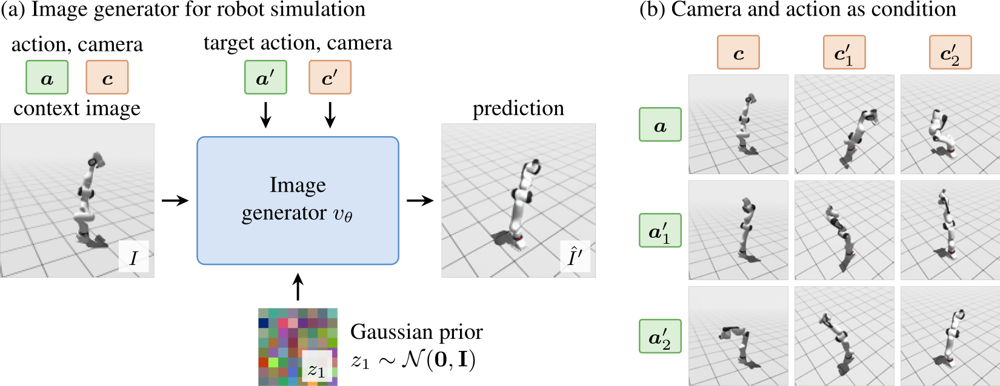
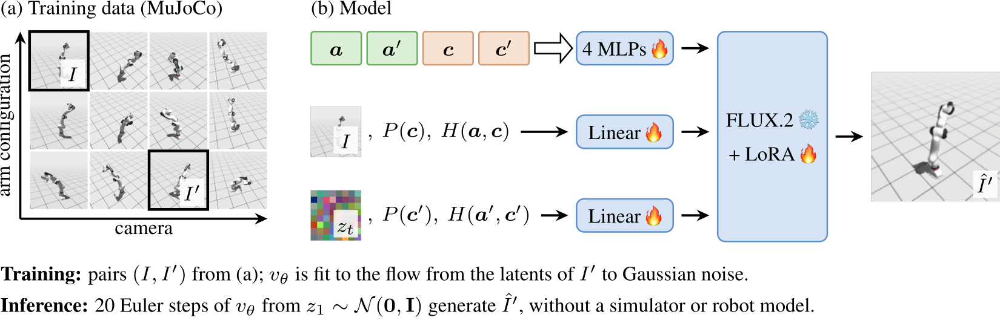
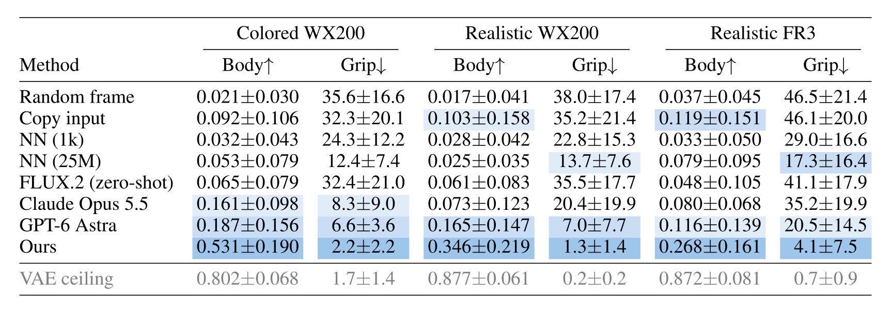
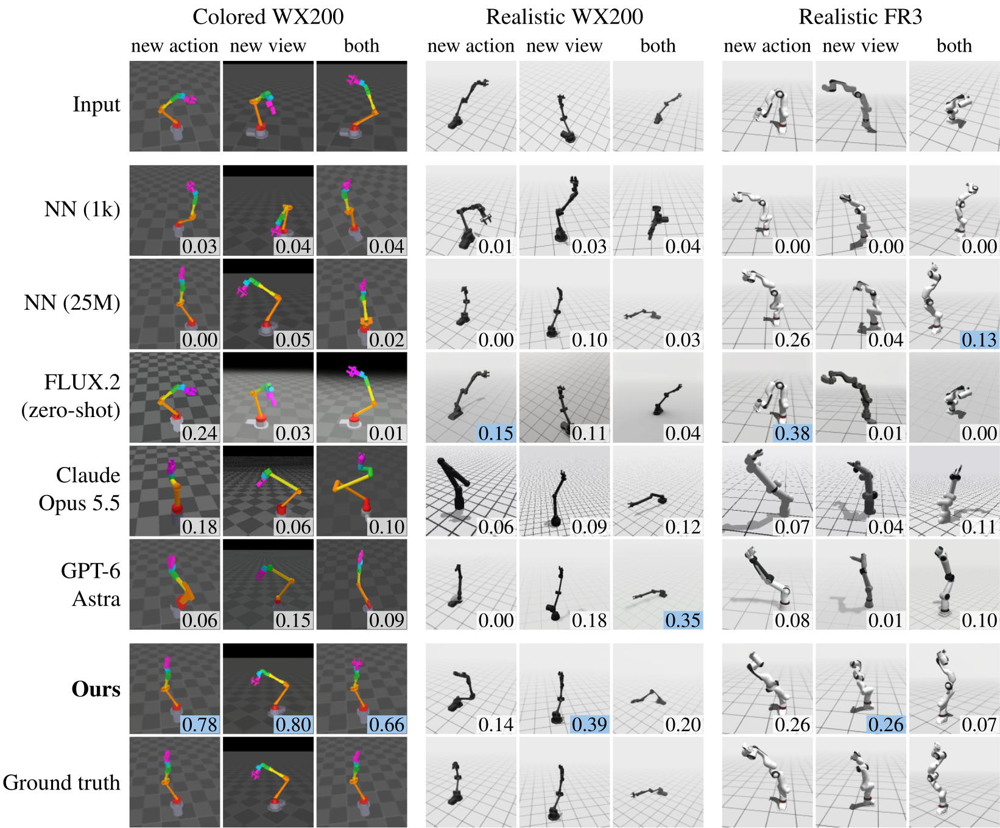
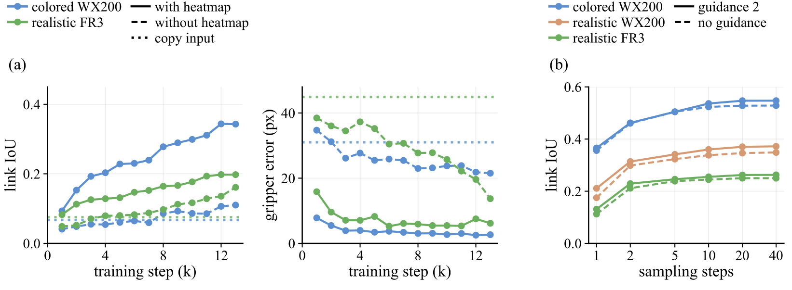
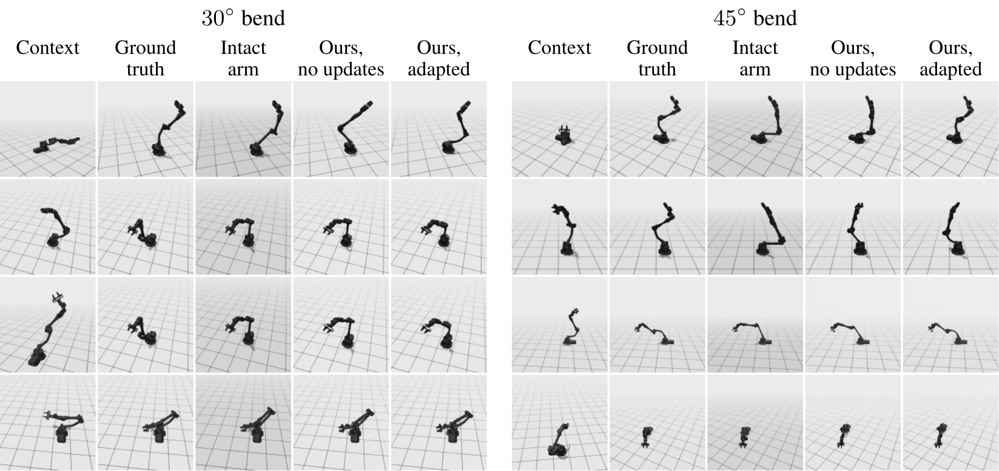
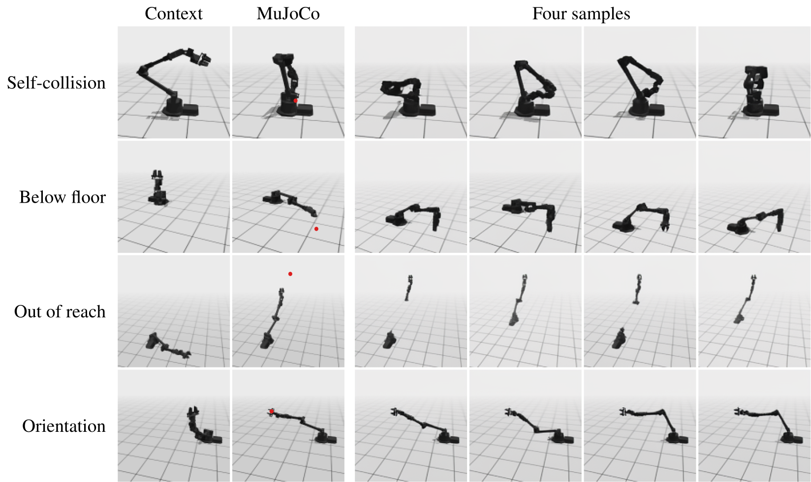

# PSRS: Pixel-Space Robot Simulation

**Pre-trained Image Generators for Adaptive Robot Simulation**
Jiong Lin, Yihong Liu, Judah Goldfeder, Hod Lipson. Columbia University.
CoRL 2026 Workshop on The Action Gap (TAG 2026).

🌐 **[Project Website](https://jl6017.github.io/psrs/)**



*(a) From a context image with its action (end-effector pose) and camera pose, a target action and camera pose, and a sample of Gaussian noise, the image generator predicts the target image. (b) Eight predictions of one model from one input image (top left) under new actions (rows) and new cameras (columns); realistic Franka FR3, first test scene.*

## Abstract

Action-conditioned generative models of robots usually use egocentric views from the robot's cameras, which limit the view to the gripper and its workspace and leave the rest of the body unseen. We study the third-person view: given one image of a robot with its end-effector and camera poses, render the whole robot at a new end-effector pose, from a new camera pose, or both. At test time, the model needs no URDF, joint angles or simulator. We fine-tune the image generator FLUX.2 with LoRA on image pairs streamed from MuJoCo, and give it the end-effector and camera poses as condition tokens together with a per-pixel end-effector ray heatmap. On a 5-DoF WidowX 200 in two render styles and a 7-DoF Franka FR3, the predicted arm reaches a body IoU, the mean IoU of the arm links below the wrist, of 0.27–0.53, against at most 0.08 for nearest-neighbor retrieval and 0.19 for large language models that write rendering code. When the robot's upper arm is bent, continuing to train the model on 30–300 trajectories of the modified robot adapts it toward the new body.

## Method



*(a) Inside the training loop, MuJoCo renders a trajectory of arm configurations (rows) from four cameras (columns), and a training pair (I, I′) is drawn from it. (b) Each latent token of the context image and of the noisy target is concatenated with the Plücker coordinates P of its camera rays and its end-effector ray heatmap H, and embedded by FLUX.2's patch embedding, extended with trained weights for P and H. 🔥 trained, ❄️ frozen.*

## Results



*48 test pairs per setting (16 per mode), mean ± std over pairs; ours: 4 sampling seeds. Body: mean IoU of the arm links below the wrist. Grip: gripper centroid error in pixels (128×128). Shading: best, second and third.*



*Predictions on the test set: the first test pair of each mode. Corner number: body IoU; blue: best per pair.*

## Ablation and adaptation



*(a) Link IoU and gripper error on the 192 test pairs every 1,000 steps, with and without the heatmap at the same learning rate. (b) Link IoU of the final models against sampling steps, with and without guidance.*



*A bent upper arm, 30° (left) and 45° (right): the four test pairs per angle where the bend changes the arm most, picked before prediction. Intact arm: the unbent robot at the same end-effector and camera poses. Adapted: on 300 trajectories of the bent robot.*



*Out-of-distribution action inputs (realistic WX200, first pair of each category). MuJoCo: the colliding pose (top two rows) or the closest reachable pose (bottom two rows); red dot: requested end-effector position.*

## Citation

```bibtex
@inproceedings{lin2026pretrained,
  title={Pre-trained Image Generators for Adaptive Robot Simulation},
  author={Lin, Jiong and Liu, Yihong and Goldfeder, Judah and Lipson, Hod},
  booktitle={CoRL 2026 Workshop on The Action Gap},
  year={2026}
}
```
